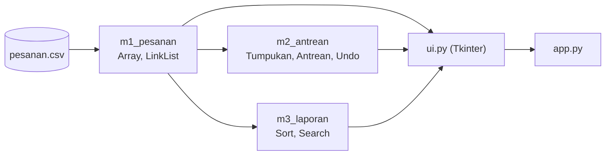

# 2EZ4U APP

Proyek akhir Struktur Data & Analisa Algoritma (EC234303), Teknik Komputer ITS.

| | |
|---|---|
| Nama | Nabil Mirza Razaqan |
| NRP | 5024251119|
| Dosen | Ir. Arta Kusuma Hernanda, S.T., M.T. |

## Deskripsi

Aplikasi layanan antar makanan versi mini. Semua struktur data dan algoritma dibuat sendiri, tanpa `dict`, `set`, `sorted`, `.sort()`, `heapq`, `bisect`, dan `collections`. Tampilannya satu jendela Tkinter. Milestone yang sudah selesai: M1, M2, M3.

## Cara menjalankan

Butuh Python 3.11 atau lebih baru.

```
git clone https://github.com/mirzarazaqan-stack/2ez4u.git
cd 2ez4u
python app.py
```

Klik menu **Load** dulu, baru menu lain bisa dipakai.

Tes: `python -m unittest tests.tes_m1_m2 tests.tes_m3 -v`

Benchmark M3: `python -m tests.benchmark_m3`

## Struktur

```
2ez4u/
|-- README.md
|-- app.py
|-- data/        pesanan.csv, peta.csv
|-- backend/     m1_pesanan.py, m2_antrean.py, m3_laporan.py
|-- frontend/    ui.py
|-- tests/       tes_m1_m2.py, tes_m3.py, benchmark_m3.py
|-- docs/        screenshot dan grafik
```

## Diagram



## Screenshot


## Video demo
-----------


## M1: Array vs Linked List

Pesanan REGULER masuk belakang, PRIORITAS ke tengah, VIP ke depan.

| Operasi (200.000 data) | Array | Linked List |
|---|---|---|
| Tambah VIP | 200.000 digeser | 0 ditelusuri |
| Tambah PRIORITAS | 100.000 digeser | 99.999 ditelusuri |

Kenapa kapasitas array dilipatduakan, dan kenapa linked list punya `tail`:

TODO: tulis dengan kata-katamu sendiri.

## M2: Stack dan Queue

- Kasir: infix diubah ke postfix lalu dihitung, keduanya pakai tumpukan.
- Undo/redo: dua tumpukan. Aksi baru mengosongkan redo.
- Antrean naif (geser semua tiap dequeue) dibanding antrean melingkar.

Antrean berisi 19.850 pesanan:

| | Naif | Melingkar |
|---|---|---|
| Dequeue 1 kali (digeser) | 19.849 | 0 |
| Dequeue 100 kali (digeser) | 1.979.950 | 0 |
| Waktu dequeue 100 kali | TODO | TODO |

Kenapa antrean melingkar butuh `count`, dan kenapa `pop` pertama di postfix adalah operand kanan:

TODO: tulis dengan kata-katamu sendiri.

## M3: Sort dan Search

| Algoritma | Kompleksitas | Catatan |
|---|---|---|
| Insertion sort | O(n^2) | stabil, maksimal 20.000 baris |
| Merge sort | O(n log n) | stabil, sanggup 200.000 baris |
| Linear search | O(n) | data tidak perlu terurut |
| Binary search | O(log n) | data harus terurut oid |

Insertion sort vs merge sort (hasil `python -m tests.benchmark_m3`):


Linear search vs binary search:


Alasan memilih algoritma:

## Catatan

- Dequeue naif hanya pembanding, tidak masuk undo. Yang bisa di-undo: ENQUEUE dan DEQUEUE CIRCULAR.
- Antrean melingkar tumbuh dua kali lipat saat penuh.
- Modul `csv` hanya dipakai untuk membaca file.
- Kunci sort `selesai`: pesanan yang belum selesai ditaruh paling belakang.
- Insertion sort menolak lebih dari 20.000 baris.
